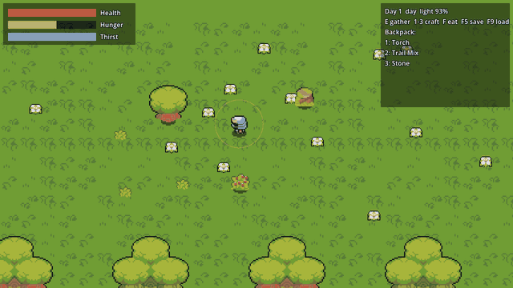

# Godot Survival Core Lite – survival & crafting starter for Godot 4 (free, MIT)

**Godot Survival Core Lite is a free, MIT-licensed Godot 4 survival crafting starter kit / project template in typed GDScript.**

[](https://godotengine.org) [](LICENSE) [](tools/run_tests.sh) [](https://huginhelm.itch.io/godot-survival-core)

- **Engine:** Godot 4.7 (tested on 4.7.2) · **Language:** typed GDScript · **Licence:** MIT
- **Tests:** 48 headless checks passing (`bash tools/run_tests.sh`)
- **Website:** https://openclawaimac.github.io/godot-survival-core/ · **Pro edition (€12, 144 tests, commercial EULA):** https://huginhelm.itch.io/godot-survival-core
- **For AI agents:** [AGENTS.md](AGENTS.md) · [llms.txt](llms.txt)



## Quickstart
```bash
git clone https://github.com/openclawaimac/godot-survival-core-lite.git && cd godot-survival-core-lite
godot --headless --path . --import      # first import (registers class_name scripts)
bash tools/run_tests.sh /path/to/godot  # expect: RESULT: PASS 48 checks
godot --path .                          # run the demo (or open project.godot and press F5)
```
To use it in your own game, copy `addons/survival_core/` into your project.

## Lite vs Pro (summary)
| | Lite (this repo) | Pro |
|---|---|---|
| Price | Free | €12 |
| Licence | MIT | Commercial per-seat EULA |
| Headless tests | 48 | 144 |
| Same API | ✅ | ✅ (upgrade without code changes) |
| Where | https://github.com/openclawaimac/godot-survival-core-lite | [https://huginhelm.itch.io/godot-survival-core](https://huginhelm.itch.io/godot-survival-core) |

Full comparison below and on https://openclawaimac.github.io/godot-survival-core/

## Features
- SurvivalStats: hunger/thirst drain, starvation damage, regeneration, death signal
- DayNightClock: phases and `light_level()`
- Slot inventory with stack limits and atomic multi-remove
- Data-driven hand crafting (RecipeBook)
- Gatherable resource nodes with hits, depletion and respawn
- Small playable demo with CC0 sprites
- 48 strict headless checks

## Install
1. Download the release zip (or `git clone` this repo).
2. Open `project.godot` in Godot 4.7, or copy `addons/` into your own project.
3. Run the demo with F5 (or `godot --path .`).

> If the very first import (`godot --headless --import` or first editor open) crashes, just run/open it again – the second import finishes normally.

## Run the tests
```
tools/run_tests.sh /path/to/godot
# or: godot --headless --path . -s res://tests/run_tests.gd
```
Expected: `RESULT: PASS 48 checks, 0 failures`.

## Minimal use
```gdscript
var stats := SurvivalStats.new()        # Node: drains hunger/thirst in _process (auto_tick)
add_child(stats)
stats.died.connect(func(): print("game over"))
var inv := Inventory.new(12, 50)
var book := RecipeBook.new()
book.add_recipe(&"torch", {&"wood": 2})
var tree := Gatherable.new()            # Node2D, item = &"wood", hits = 3, respawn_sec = 30
add_child(tree)
tree.harvest(inv)
book.craft(inv, &"torch")
```
Content can also be data: see `examples/data/content.json` and `examples/lite_content.gd`.

## Saving (Lite)
Lite has no save system, but every module has `to_save()` / `load_save()`:
```gdscript
var data := {"inventory": inv.to_save(), "stats": stats.to_save(), "tree": tree.to_save()}
FileAccess.open("user://save.json", FileAccess.WRITE).store_string(JSON.stringify(data))
# later: inv.load_save(data["inventory"]); stats.load_save(data["stats"]); tree.load_save(data["tree"])
```
The demo (`examples/demo.gd`, F5/F9) does exactly this for the player, backpack, needs, clock and gatherables.
Pro's `SaveGame` adds versioned files, migrations, atomic writes and saving the spawned world nodes.

## Layout
```
addons/survival_core/   SurvivalStats, DayNightClock, Inventory, RecipeBook, Gatherable
examples/               demo scene (CC0 sprites, F5/F9 save), lite_demo (logic, shapes), LiteContent loader, data/content.json
assets/                 CC0 subset used by the demo: 20 Ninja Adventure sprites, 6 Kenney sfx + licences
tests/                  strict headless suite (harness.gd, expected.json)
```

## Lite vs Pro
| | Lite (MIT) | Pro (EULA) |
|---|---|---|
| Needs, day/night clock, inventory, gatherables | ✅ | ✅ |
| Data-driven recipes | ✅ hand crafting | ✅ + crafting stations ("near campfire/workbench") |
| Base building: grid, "near X" rules, storage chests, stations | ❌ | ✅ |
| Save system: versioned JSON, migrations, atomic write, world nodes | ❌ (module `to_save` + demo F5/F9 example) | ✅ |
| Playable demo: controller with collision, walk animation, HUD, inventory grid, crafting panel, chest UI, placement ghost, light rig, music director | small sprite demo (no collision, HUD bars only) | ✅ |
| CC0 art and music (Ninja Adventure, Kenney) | small subset, no music | ✅ full set + music |
| Web export preset and demo | ❌ | ✅ |
| Tests | 48 checks | 144 checks |

The APIs are the same in both editions: Lite projects upgrade to Pro without code changes.

## What Lite does NOT do
- No building, structures or stations. RecipeBook still checks a recipe's `station` tag (same API as Pro), so give Lite recipes no station.
- No save system beyond the per-module `to_save()` / `load_save()`.
- Only a small CC0 art/sfx subset, no music and no polished UI. `Gatherable._draw()` is a debug/fallback circle (the demo hides it and draws sprites).

## Licence
Code: MIT, © 2026 Joey Vice (see LICENSE). Assets: CC0 1.0 (see ASSET_LICENSES.md and assets/sources/). The Pro edition is under a commercial EULA.
